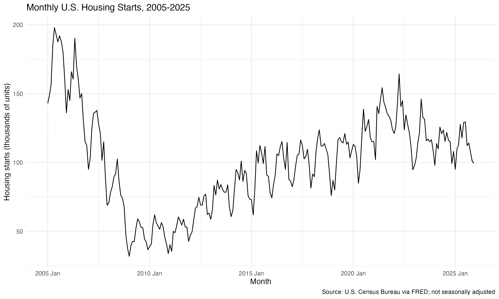
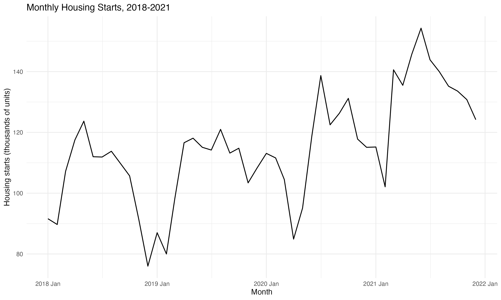
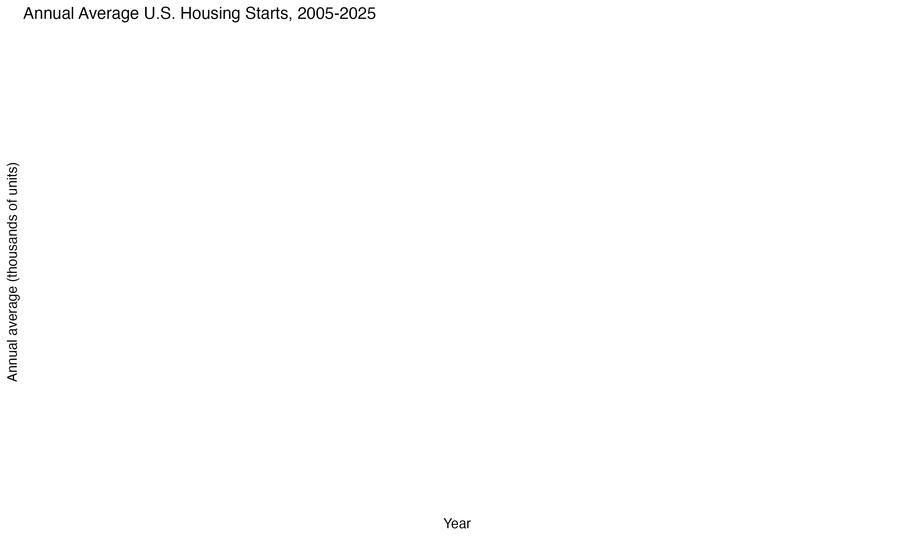
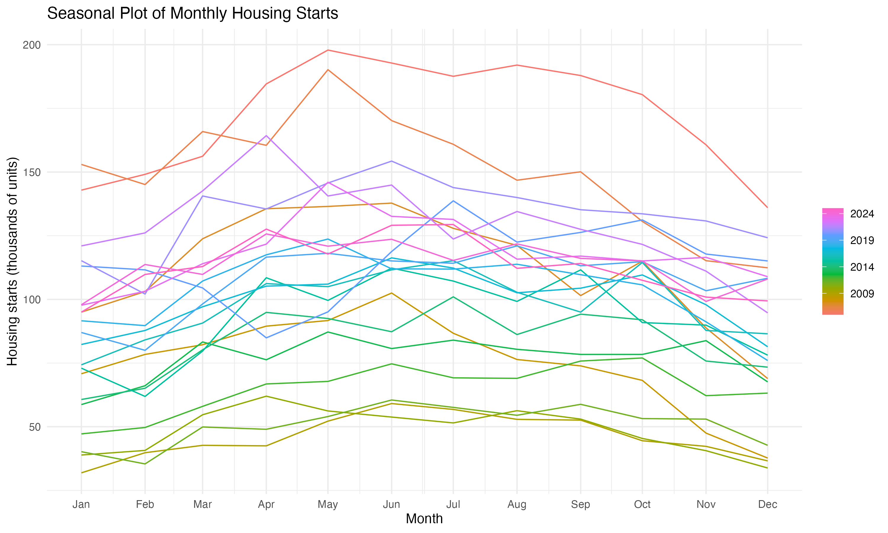
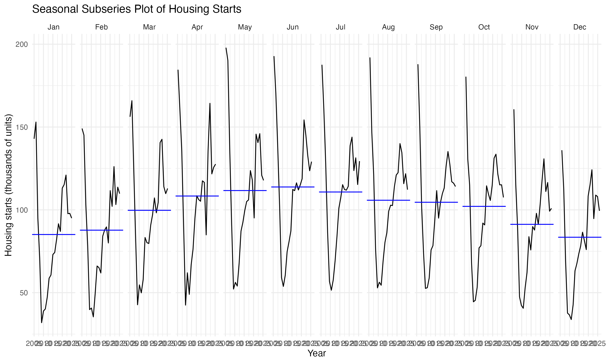
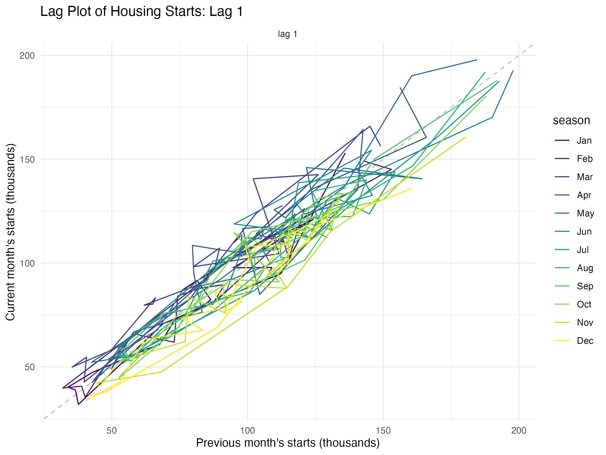
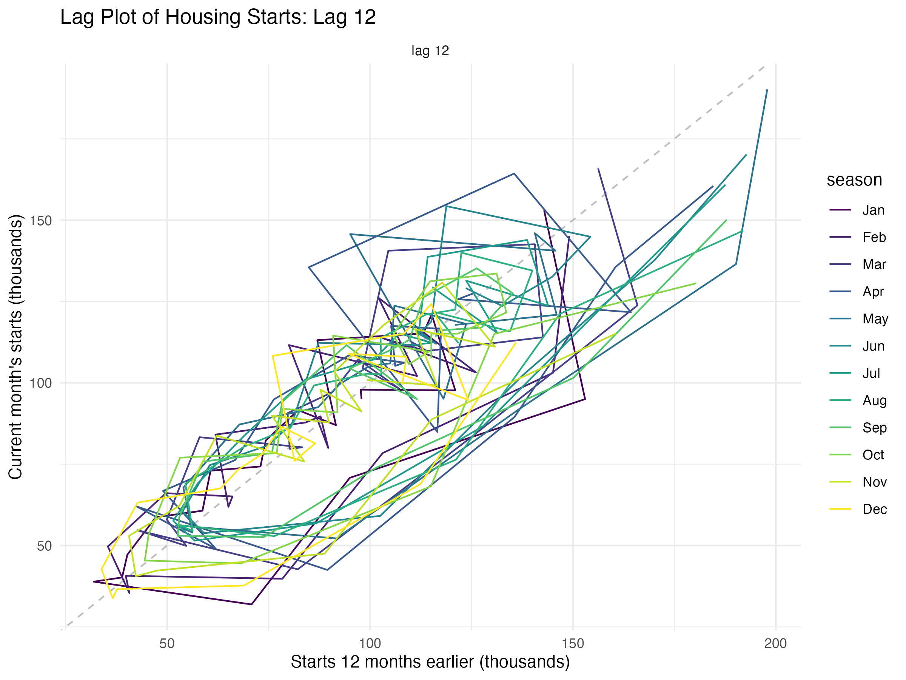
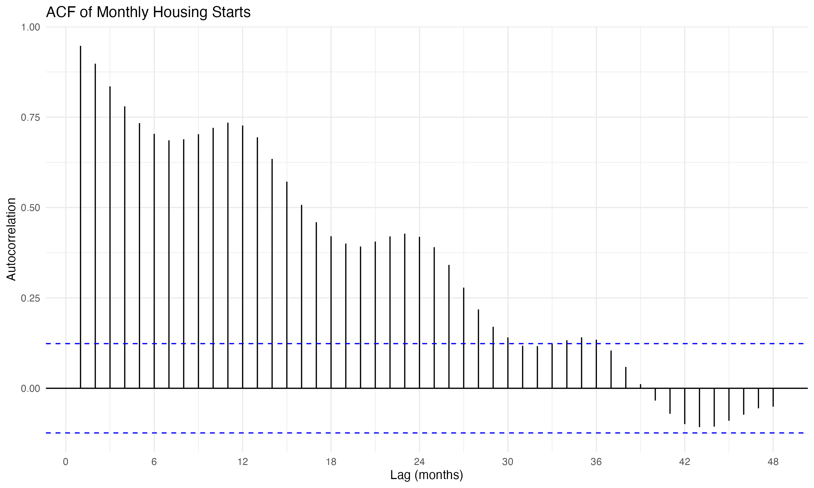
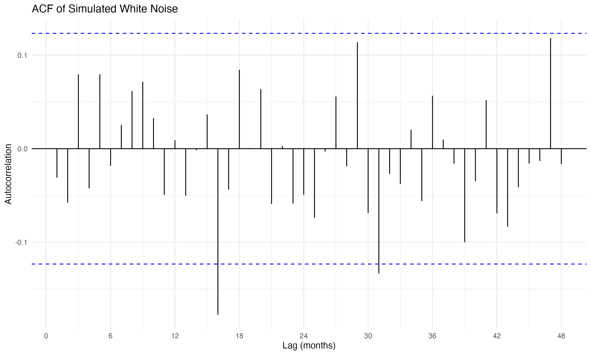

# U.S. Housing Starts: Time Series Analysis

Exploratory time series analysis of monthly U.S. housing starts (January 2005 to December 2025) in R. The project uses housing starts as a gauge of business conditions and examines trend, seasonality, and autocorrelation.

## Datasets

### 1. Source data (external)

| Item | Details |
|---|---|
| File | `HOUSTNSA.csv` |
| Series | HOUSTNSA: New Privately-Owned Housing Units Started, Total |
| Source | [FRED](https://fred.stlouisfed.org/series/HOUSTNSA) |
| Producer | U.S. Census Bureau (FRED only hosts the data) |
| Frequency | Monthly |
| Units | Thousands of housing units |
| Seasonal adjustment | None (not seasonally adjusted) |
| Columns | `observation_date`, `HOUSTNSA` (renamed to `date`, `starts` in the code) |
| Sample used | 2005-01-01 to 2025-12-01 (252 monthly observations) |

### 2. Datasets created in the code

| Object | Description |
|---|---|
| `housing_raw` | The CSV exactly as read in |
| `housing` | Cleaned data: renamed columns, proper date and numeric types, filtered to 2005-2025, sorted |
| `housing_ts` | `tsibble` time series indexed by month (the main dataset for all analysis) |
| `housing_short` | Subset of `housing_ts` for 2018-2021, used to zoom in on the COVID period |
| `annual` | Annual average of monthly starts (only years with all 12 months) |
| `white_ts` | Simulated white noise series (252 observations, seed `3232026`), used as a baseline for comparing autocorrelation |

## Graphs

All plots are saved in the `results/Graphs/` folder and are generated when you knit `A1-Nanavati-Neel.Rmd`. They appear below once the PNG files are in `results/Graphs/` in the repository.

### 1. Monthly housing starts, 2005-2025

Time plot of all 252 months. Shows the mid-2000s boom, the crash around the financial crisis, the slow recovery, and the 2020 COVID dip.



### 2. Monthly housing starts, 2018-2021

Zoomed time plot of the spring 2020 shock and the rebound.



### 3. Annual average housing starts

Annual averages smooth out seasonality to show the long-run trend.



### 4. Seasonal plot

Each year drawn as its own line across the 12 months, so the same months can be compared across years.



### 5. Seasonal subseries plot

One panel per calendar month, with a line at that month's average.



### 6. Lag plot, lag 1

Each month's starts against the previous month's. Shows short-term dependence.



### 7. Lag plot, lag 12

Each month's starts against the same month a year earlier. Shows the seasonal link.



### 8. ACF of housing starts

Autocorrelation up to 48 lags. Bars outside the blue bands indicate real structure (trend and seasonality).



### 9. ACF of simulated white noise

Baseline for what no pattern looks like (seed 3232026). Bars should mostly stay within about +/-0.123.



## What the analysis does

1. **Load and clean** the FRED data
2. **Validate** the series: duplicates, missing values, and missing months
3. **Time plots**: full sample, a 2018-2021 zoom, and annual averages (graphs 1-3)
4. **Seasonal plots**: seasonal and subseries plots (graphs 4-5)
5. **Lag plots and ACF**: lag 1, lag 12, and autocorrelation compared with white noise (graphs 6-9)
6. **Discussion**: patterns, forecasting, and data revisions

## How to run

1. Clone or download this repository.
2. Keep `HOUSTNSA.csv` in the same folder as `A1-Nanavati-Neel.Rmd`.
3. Install the required packages (once):
   ```r
   install.packages(c("readr", "dplyr", "tsibble", "lubridate",
                      "ggplot2", "feasts", "ggtime"))
   ```
4. Open `A1-Nanavati-Neel.Rmd` in RStudio and click **Knit**.

## Requirements

R packages: `readr`, `dplyr`, `tsibble`, `lubridate`, `ggplot2`, `feasts`, `ggtime`

## Files

- `A1-Nanavati-Neel.Rmd`: analysis code and write-up
- `A1-Nanavati-Neel.html`: knitted report
- `HOUSTNSA.csv`: source data
- `results/Graphs/`: saved plots (listed above)

## Author

Neel Nanavati

## Data note

FRED data is revised over time, so numbers downloaded later may differ slightly from earlier releases.
